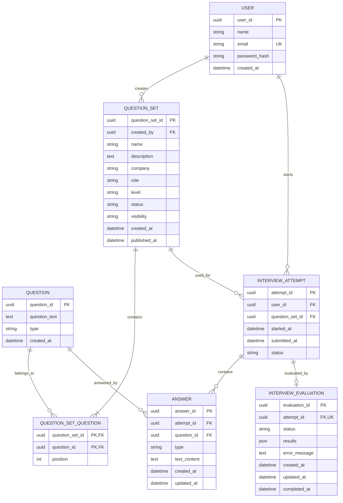

# AI Interview Coach — Domain Model & Logical Data Model

**Document Version:** 1.0  
**Status:** Draft  
**Project:** AI Interview Coach

---

## 1. Purpose

This document defines the core domain entities, their attributes, relationships, constraints, and business rules for the AI Interview Coach.

The model supports question-set creation, interview attempts, text and voice answers, AI evaluation, and evaluation retries.

It describes the logical data model independently of the final database technology and physical implementation.

## 2. Domain Overview

The system consists of seven persistent entities:

1. `User`
2. `Question`
3. `QuestionSet`
4. `QuestionSetQuestion`
5. `InterviewAttempt`
6. `Answer`
7. `InterviewEvaluation`

Conversation history is session-only and is not persisted in the database. Therefore, `Conversation` and `Message` are excluded from the data model.

## 3. Domain Model Diagram



*Note: The diagram illustrates the logical relationships. Exact database types, including UUID and JSON support, will be finalized during physical database design.*

## 4. Entity Definitions

### 4.1 User

Represents a registered user who can create custom question sets and perform interview attempts.

| Attribute | Type (logical) | Constraints | Description |
|---|---|---|---|
| `user_id` | UUID | Primary key | Unique user identifier |
| `name` | String | Required | User's display name |
| `email` | String | Required, unique | Login email address |
| `password_hash` | String | Required | Securely hashed password |
| `created_at` | DateTime | Required | Account creation timestamp |

**Business rules**

- Each user must have a unique email address.
- Passwords must never be stored in plaintext.
- A user may create multiple question sets and interview attempts.
- Ownership of attempts and custom question sets is determined through `user_id` and `created_by`, respectively.

### 4.2 Question

Represents an individual interview question that can be reused across multiple question sets.

| Attribute | Type (logical) | Constraints | Description |
|---|---|---|---|
| `question_id` | UUID | Primary key | Unique question identifier |
| `question_text` | Text | Required | Question wording |
| `type` | String / Enum | Required | Question category |
| `created_at` | DateTime | Required | Creation timestamp |

**Allowed question types**

- `technical`
- `hr`
- `soft_skill`

**Business rules**

- A question may belong to multiple question sets.
- Questions are immutable after creation. If the wording or meaning needs to change, a new question record must be created.
- Difficulty is defined at the question-set level, not at the individual question level.
- Question records are not duplicated merely because the same question is included in another set.

### 4.3 QuestionSet

Represents a collection of ordered questions for a particular company, role, and experience level.

Question sets may be created by the platform or by users.

| Attribute | Type (logical) | Constraints | Description |
|---|---|---|---|
| `question_set_id` | UUID | Primary key | Unique question-set identifier |
| `created_by` | UUID | Nullable foreign key → `User.user_id` | Creator; `NULL` identifies platform-created sets |
| `name` | String | Required | Question-set name |
| `description` | Text | Optional | Description of the set |
| `company` | String | Optional | Associated company |
| `role` | String | Required | Target job role |
| `level` | String / Enum | Required | Target experience level |
| `status` | String / Enum | Required | Publication lifecycle status |
| `visibility` | String / Enum | Required | Access visibility |
| `created_at` | DateTime | Required | Creation timestamp |
| `published_at` | DateTime | Nullable | Publication timestamp |

**Allowed values**

- `status`: `draft`, `published`
- `visibility`: `private`, `public`

The exact allowed values for `level` will be defined before physical implementation.

**Business rules**

- Both the platform and users can create question sets.
- `created_by = NULL` identifies a platform-created set under the current model.
- Draft sets may be edited by their authorized owner or platform administrator.
- Published sets are immutable, including their question membership and ordering.
- If a published set needs modification, a new set must be created.
- Public sets are available for other users to practice with, but users cannot copy or modify them under the current product rules.
- Public visibility is permitted only for published sets.
- Only published sets may be used to start interview attempts.

### 4.4 QuestionSetQuestion

Associative entity implementing the many-to-many relationship between `QuestionSet` and `Question`.

It also records the display order of questions within a set.

| Attribute | Type (logical) | Constraints | Description |
|---|---|---|---|
| `question_set_id` | UUID | Primary key component; foreign key → `QuestionSet.question_set_id` | Associated set |
| `question_id` | UUID | Primary key component; foreign key → `Question.question_id` | Associated question |
| `position` | Integer | Required | Question's position within the set |

**Constraints**

- Composite primary key: (`question_set_id`, `question_id`).
- Unique constraint: (`question_set_id`, `position`).
- `position` must be a positive integer.

**Business rules**

- A question may appear only once within a given set.
- The same question may appear in different sets.
- Question order is preserved after publication.
- This entity avoids duplicating question content across sets.

### 4.5 InterviewAttempt

Represents one complete practice session using a specific published question set.

An attempt may be paused and resumed before submission.

| Attribute | Type (logical) | Constraints | Description |
|---|---|---|---|
| `attempt_id` | UUID | Primary key | Unique attempt identifier |
| `user_id` | UUID | Required foreign key → `User.user_id` | User performing the interview |
| `question_set_id` | UUID | Required foreign key → `QuestionSet.question_set_id` | Question set being attempted |
| `started_at` | DateTime | Required | Time the attempt started |
| `submitted_at` | DateTime | Nullable | Time the attempt was submitted |
| `status` | String / Enum | Required | Attempt lifecycle status |

**Allowed values**

- `in_progress`
- `submitted`

**Business rules**

- Each attempt belongs to exactly one user and one question set.
- A user may have multiple attempts using the same question set.
- An attempt may be paused and resumed while its status is `in_progress`.
- Submission locks the attempt and all its answers.
- Users may submit incomplete attempts.
- Once submitted, an attempt cannot be reopened, edited, or resubmitted.
- To practice again, the user must start a new attempt.
- Evaluation status is tracked separately in `InterviewEvaluation`.
- Only published question sets may be used to create attempts.

### 4.6 Answer

Represents a user's response to one question within an interview attempt.

Both text and voice input are supported. Voice input is transcribed into text before being saved.

| Attribute | Type (logical) | Constraints | Description |
|---|---|---|---|
| `answer_id` | UUID | Primary key | Unique answer identifier |
| `attempt_id` | UUID | Required foreign key → `InterviewAttempt.attempt_id` | Associated attempt |
| `question_id` | UUID | Required foreign key → `Question.question_id` | Question being answered |
| `type` | String / Enum | Required | Original input method |
| `text_content` | Text | Required for a saved answer | Answer text or voice transcription |
| `created_at` | DateTime | Required | Initial save timestamp |
| `updated_at` | DateTime | Required | Last update timestamp |

**Allowed values**

- `type`: `text`, `voice`

**Constraints**

- Unique constraint: (`attempt_id`, `question_id`).
- An answer must reference a question belonging to the attempt's question set.
- `text_content` must contain the successfully saved answer text.

**Business rules**

- Only one answer record exists per question per attempt.
- Editing a text answer or re-recording a voice answer overwrites the existing answer.
- `created_at` remains unchanged when an answer is updated; `updated_at` changes.
- Voice recordings are transcribed, and only the resulting text is persisted.
- If transcription fails, the user is asked to repeat the answer.
- Unanswered questions do not require placeholder answer records.
- Answer completeness is determined by comparing the attempt's question set with its saved answers.
- Answers become immutable when their attempt is submitted.

### 4.7 InterviewEvaluation

Represents the overall AI-generated evaluation of a submitted interview attempt.

Evaluation covers all saved answers in the attempt, rather than generating independent evaluation records per question.

| Attribute | Type (logical) | Constraints | Description |
|---|---|---|---|
| `evaluation_id` | UUID | Primary key | Unique evaluation identifier |
| `attempt_id` | UUID | Required, unique foreign key → `InterviewAttempt.attempt_id` | Associated attempt |
| `status` | String / Enum | Required | Evaluation lifecycle status |
| `results` | JSON | Nullable until results are available | Structured evaluation output |
| `error_message` | Text | Nullable | Latest evaluation failure details |
| `created_at` | DateTime | Required | Initial record creation timestamp |
| `updated_at` | DateTime | Required | Latest record update timestamp |
| `completed_at` | DateTime | Nullable | Completion time of the latest successful run |

**Allowed values**

- `pending`
- `in_progress`
- `completed`
- `failed`

**Expected evaluation results**

The `results` structure should support:

- Overall score and relevant scoring breakdown.
- Strengths.
- Weaknesses and areas for improvement.
- Feedback and actionable recommendations.
- Feedback referencing individual questions and answers.
- Number of answered questions versus total questions in the attempt.

The exact JSON structure will be defined during API and implementation design.

**Business rules**

- An attempt can have at most one evaluation record.
- Only submitted attempts can be evaluated.
- Evaluation considers only saved answers.
- Unanswered questions must not receive invented answers or scores.
- Incomplete attempts must clearly communicate the number of answered questions, such as `7 of 10 questions completed`.
- If evaluation fails, the user may retry without resubmitting the interview or changing its answers.
- A retry reuses and updates the existing evaluation record rather than creating a new one.
- Each retry replaces the previous results and status.
- A successful retry clears the previous error message and updates the results and completion timestamp.
- Because retries overwrite the record, historical evaluation runs and previous failure details are not preserved.
- `completed_at` is null until a successful evaluation completes.

## 5. Relationships and Cardinalities

| Relationship | Cardinality | Explanation |
|---|---|---|
| `User` → `QuestionSet` | One-to-many | A user can create multiple custom question sets. Platform-created sets use a null creator. |
| `QuestionSet` ↔ `Question` | Many-to-many | A set contains multiple questions, and a question can appear in multiple sets. Implemented through `QuestionSetQuestion`. |
| `User` → `InterviewAttempt` | One-to-many | A user can perform multiple interview attempts. |
| `QuestionSet` → `InterviewAttempt` | One-to-many | A question set can be used in multiple attempts. |
| `InterviewAttempt` → `Answer` | One-to-many | An attempt can contain multiple saved answers, including zero before any answer is saved. |
| `Question` → `Answer` | One-to-many | A question can be answered in multiple attempts. |
| `InterviewAttempt` → `InterviewEvaluation` | One-to-zero-or-one | An attempt may not yet have an evaluation; if an evaluation record exists, it is unique to that attempt. |

## 6. Core Integrity Constraints

The database and application must enforce the following invariants.

1. **Identity:** `User.email` must be unique.
2. **Question uniqueness within a set:** A question cannot appear twice in the same question set.
3. **Question ordering:** A position cannot be duplicated within the same set.
4. **Valid attempt creation:** An attempt can start only with a published question set.
5. **Valid answers:** An answer must reference a question included in the associated attempt's question set.
6. **Single answer per question:** Each attempt-question pair can have at most one answer record.
7. **Submission immutability:** Submitted attempts and their answers cannot be changed.
8. **Evaluation uniqueness:** Each attempt has at most one evaluation record.
9. **Valid evaluation lifecycle:** Only submitted attempts may be evaluated.
10. **Visibility:** A question set cannot be public while still in draft status.
11. **Published set immutability:** Published question sets and their membership cannot be modified.
12. **Evaluation retry behavior:** A retry updates the existing evaluation record rather than inserting a new one.

Constraints requiring related-table checks, such as verifying that an answer's question belongs to its attempt's set, may require transactional application logic, database triggers, or an appropriate composite-key design.

## 7. Data Lifecycle and State Transitions

### Interview attempt

```text
Create attempt
     |
     v
 in_progress <---- Pause / Resume
     |
     v
  submitted
     |
     v
  Immutable
```

Submission is a one-way transition. There is no transition from `submitted` back to `in_progress`.

### Evaluation

```text
   pending
      |
      v
 in_progress
   /     \
  v       v
failed  completed
  |         ^
  |         |
  +-> Retry-+
```

A retry reuses the existing evaluation record. A failed evaluation may be retried, while a completed evaluation does not need to be repeated under the current policy.

## 8. Session-Only Chat History

The AI discussion feature is intentionally excluded from the persistent data model.

- Chat history is maintained in frontend session state.
- Conversation and message records are not stored in the database.
- Refreshing or ending the session may clear the history.
- The backend must receive sufficient current context to answer questions about the relevant attempt and its evaluation.
- The implementation must not depend on retrieving previous chat messages from the database.

## 9. Security and Data Integrity Considerations

- Store passwords using a secure password-hashing algorithm.
- Enforce authorization on custom question sets and interview attempts.
- A user must not access or modify another user's private data.
- Validate all state transitions on the backend rather than relying on frontend controls.
- Prevent answer modification after submission, including through direct API requests.
- Ensure that evaluation retries cannot run concurrently in a way that produces conflicting results.
- Avoid storing raw voice recordings when the product requires only transcribed text.
- Validate evaluation output before persisting it in `results`.

## 10. Scope Boundaries and Future Considerations

The current model deliberately excludes:

- Persistent conversation and message records.
- Separate evaluation records for individual questions.
- Historical evaluation-run records.
- Audio-file storage.
- Individual question difficulty.
- Detailed administrator audit records.
- Password-reset and email-verification entities.

These may be introduced later if product requirements change.

## 11. Open Decisions Before Physical Database Design

The following details should be finalized before implementing the schema:

- Exact allowed values for `QuestionSet.level`.
- The physical representation of the evaluation results JSON.
- Whether question-set publication requires a minimum number of questions.
- Whether draft question sets can be deleted and how deletion affects related records.
- Exact foreign-key deletion behavior, particularly for users, question sets, and questions.
- Whether the chosen database supports the required composite constraints directly or needs additional transactional validation.

---

**End of document.**